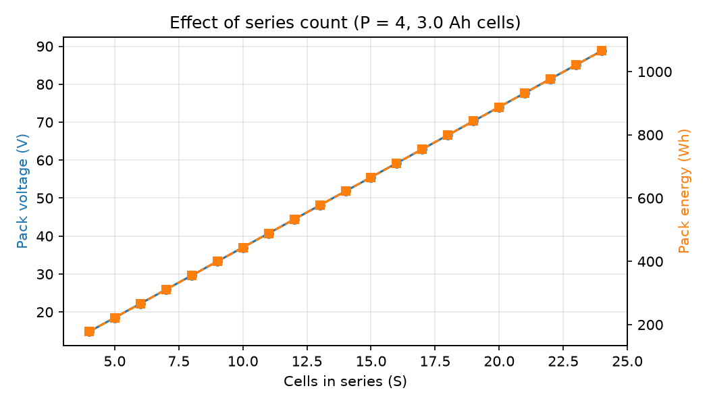
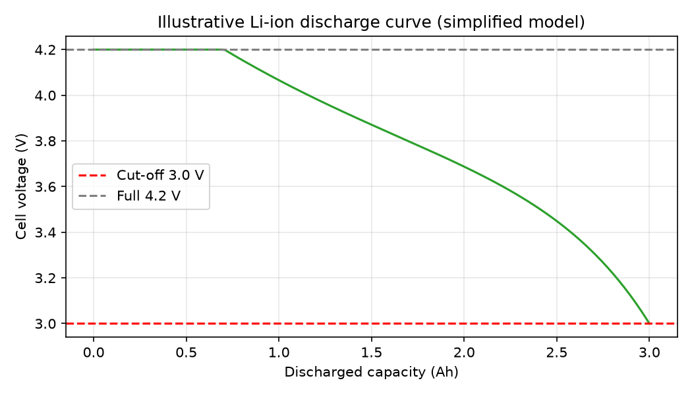
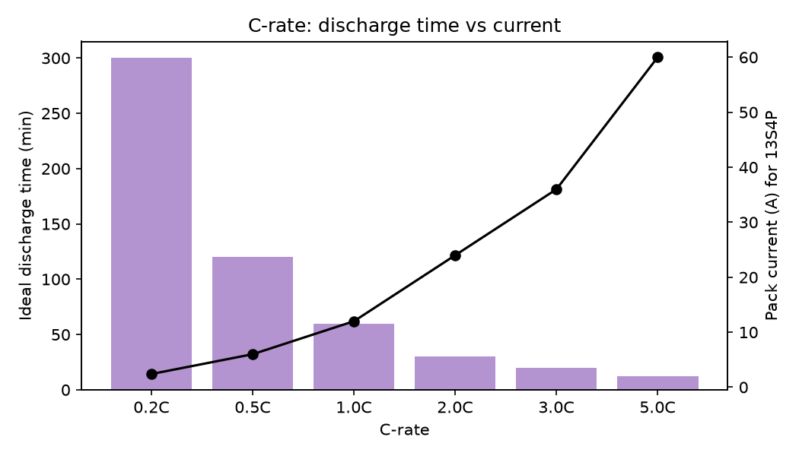

# How an EV Battery Pack Works: Cells, Packs and the BMS

**Author:** Nischith, Mechanical Engineering sem 1, UVCE Bangalore

**marvelLevel:** level 0

**Tags:** EV, Li-ion, battery pack, BMS, C-rate, Python

---

## 1. Introduction

The battery is the most important and most expensive part of an electric vehicle. It decides how far the vehicle can go, how fast it can accelerate and how safe it is. But an EV battery is not one big cell. It is hundreds or thousands of small cells connected in a smart way and watched over by an electronic controller.

In this article, I explain how a battery pack is built from single cells, how to calculate its voltage, capacity and energy, what the Battery Management System (BMS) does, and what C-rate means. I also include a small Python program that does the pack calculations and draws the graphs.

## 2. From Cell to Pack

A **cell** is the smallest unit. A common Li-ion cell (like the 18650) has these typical values:

| Parameter | Value |
|---|---|
| Nominal voltage | 3.7 V |
| Fully charged voltage | 4.2 V |
| Cut-off (empty) voltage | 3.0 V |
| Capacity (example) | 3.0 Ah |

One cell is far too small to run a vehicle, so cells are grouped:

- **Series (S):** connecting cells end to end **adds the voltage**. The capacity (Ah) stays the same.
- **Parallel (P):** connecting cells side by side **adds the capacity**. The voltage stays the same.

A pack is described as **sSpP**. For example, **13S4P** means 4 cells in parallel make one group, and 13 such groups are connected in series.

The formulas are:

```
Pack voltage (V)   = S x cell voltage
Pack capacity (Ah) = P x cell capacity
Pack energy (Wh)   = Pack voltage x Pack capacity
Total cells        = S x P
```

### Python calculator

```python
V_NOM, V_MAX, V_MIN = 3.7, 4.2, 3.0   # volts
CELL_AH = 3.0                          # Ah per cell

def pack_specs(s, p, v=V_NOM, ah=CELL_AH):
    """Return (voltage V, capacity Ah, energy Wh) of an sSpP pack."""
    volt = s * v
    cap = p * ah
    return volt, cap, volt * cap

S, P = 13, 4
v, c, e = pack_specs(S, P)
print(f"{S}S{P}P pack -> {v:.1f} V nominal, {c:.1f} Ah, {e:.1f} Wh")
print(f"Full charge: {S*V_MAX:.1f} V | Cut-off: {S*V_MIN:.1f} V | Cells: {S*P}")
```

### Result for a 13S4P pack

| Quantity | Value |
|---|---|
| Nominal voltage | 48.1 V |
| Capacity | 12.0 Ah |
| Energy | 577.2 Wh |
| Full charge voltage | 54.6 V |
| Cut-off voltage | 39.0 V |
| Total cells | 52 |

This is the size of pack used in small electric two-wheelers and scooters. Larger EV cars use many more cells with much higher voltage.

Adding more cells in series increases the voltage and the energy together, as the graph below shows (with P fixed at 4):



*Figure 1: Pack voltage and energy rise linearly with the number of series cells.*

## 3. Battery Management System (BMS)

Li-ion cells are sensitive. If they are overcharged, over-discharged or overheated, they can be damaged permanently or even catch fire. The **BMS** is the electronic board that protects the pack. Its main jobs are:

1. **Over-voltage protection:** stops charging when any cell reaches 4.2 V.
2. **Under-voltage protection:** stops discharging when any cell falls to about 3.0 V.
3. **Over-current protection:** cuts off the pack during a short circuit or excessive load.
4. **Temperature monitoring:** stops charging or discharging if the pack is too hot or too cold.
5. **Cell balancing:** cells are never exactly identical, so some charge faster than others. The BMS bleeds or moves charge so all cells stay at a similar voltage. Without balancing, the weakest cell limits the whole pack.
6. **State of Charge (SoC) estimation:** it estimates how much energy is left, like a fuel gauge.

## 4. Discharge Behaviour

When a cell is discharged, its voltage does not stay constant. It starts near 4.2 V, stays fairly flat for most of the discharge, and then drops quickly near the end. This is why the BMS must stop the discharge at the cut-off voltage.



*Figure 2: Illustrative discharge curve from a simplified model. It shows the general shape only and is not measured data.*

## 5. C-rate

**C-rate** tells how fast a battery is charged or discharged compared to its capacity.

```
Current (A)          = C-rate x capacity (Ah)
Ideal time (minutes) = 60 / C-rate
```

For our 12 Ah pack:

| C-rate | Current | Ideal discharge time |
|---|---|---|
| 0.2C | 2.4 A | 300 min |
| 1C | 12 A | 60 min |
| 2C | 24 A | 30 min |
| 5C | 60 A | 12 min |

Higher C-rate means more current and more heat. Real batteries give slightly less than the ideal time at high C-rates because of internal losses.



*Figure 3: Higher C-rate gives a shorter discharge time and a higher current.*

## 6. Thermal Management

Current flowing through a pack produces heat, and Li-ion cells work best in roughly the 20 to 40 degree C range. Pack designers use:

- **Air cooling:** simple and cheap, used in small packs.
- **Liquid cooling:** coolant flows through plates near the cells. It is more effective and is used in high-power EV packs.

Pack layout, spacing between cells and airflow paths are mechanical design problems, which is where mechanical engineers contribute directly.

## 7. Key Terms

| Term | Meaning |
|---|---|
| Cell | Smallest battery unit |
| Pack | Many cells connected in series and parallel |
| BMS | Electronics that protect and monitor the pack |
| SoC | State of Charge, the percentage of energy remaining |
| C-rate | Charge or discharge current relative to capacity |
| Cell balancing | Keeping all cells at a similar voltage |

## 8. Summary

- Series connections add voltage, parallel connections add capacity.
- Pack energy (Wh) is voltage multiplied by capacity.
- A 13S4P pack of 3.0 Ah cells gives 48.1 V, 12 Ah and 577.2 Wh.
- The BMS keeps the pack safe by controlling voltage, current, temperature and balance.
- Higher C-rate means more current, faster discharge and more heat.

## References

- Datasheet of a typical 18650 Li-ion cell (manufacturer documentation)
- Battery University, "Learn about batteries": https://batteryuniversity.com
- Python documentation: https://docs.python.org
